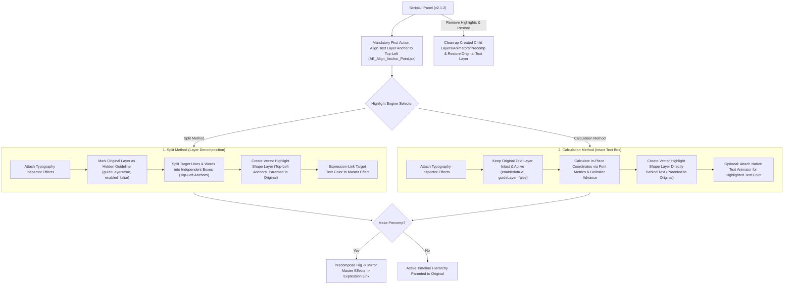

# AE Text Highlight (v2.1.2)

**Live Demo**: [https://work2survive.github.io/AE_JS_builder/?jsx=AE_Text_Highlight.jsx&autobuild=true](https://work2survive.github.io/AE_JS_builder/?jsx=AE_Text_Highlight.jsx&autobuild=true)

**AE Text Highlight v2.1.2** is an advanced procedural typography highlighting and rigging engine for Adobe After Effects ScriptUI and the [AE JS & ScriptUI Simulator](https://work2survive.github.io/AE_JS_builder/). It features a top-level engine selector allowing users to choose between two distinct highlight strategies:
1. **Split Method (Layer Decomposition)**: Decomposes target lines and words into independent text boxes with top-left anchor points, offering individual text layer control, separate text color assignments, and sub-pixel alignment.
2. **Calculation Method (Intact Text Box)**: Keeps the original text layer completely intact without splitting, calculating the exact geometric coordinates and bounding sizes of highlight boxes in-place using all available typography parameters (`fontSize`, `leading`, `tracking`, `boxTextPos`, `sourceRectAtTime`, and delimiter-anchored advance).

> [!IMPORTANT]
> **Key Enhancements in v2.1.2**:
> - **Robust Text Layer Selection**: Added parent hierarchy traversal so selecting child indicator/helper layers (e.g., Anchor Cross created in simulators) seamlessly resolves to the parent text layer.
> - **Unified Footer UI**: Moved GitHub repository link to bottom panel footer matching `AE_Text_Precomp.jsx` styling.
> - **Simulator Compatibility**: Fully verified against AE JS Builder emulator and timeline layer management.
> - **Selective Highlight Text Coloring**: Highlight box fill strictly changes only the color of the font related to highlights (via Range Selectors in Calculation Method and segment targets in Split Method). Non-highlighted text retains original font color.
> - **Highlighted Text Color Checkbox Toggle**: Added a dedicated checkbox before "Highlighted Text Color:" to enable/disable font color overrides. When unchecked, original font colors remain 100% untouched.
> - **Mandatory First-Action Anchor Alignment**: Always aligns the text layer anchor point to **Top-Left** using `AE_Align_Anchor_Point.jsx` logic with **0.00px visual shift**, regardless of method selected.
> - **Eliminated Upward Shift in Split Method**: Line 1 baseline is strictly calibrated from typographic ascender (matching `AE_Text_Precomp`), preventing glyphs from ascending into negative space.
> - **Precomp Anchor Point & Size Normalization**: Precomp layer anchor point is pinned strictly to **Top-Left** (`[0, 0, 0]`) and dimensions match the text box dimensions, eliminating baseline offsets.

---

## 📚 Knowledge Base & Referenced Repositories

The algorithms and architecture in this engine are derived from and cross-referenced with the following foundational resources:

1. **[AE vs. JS Text Rendering Differences Guide](https://github.com/work2survive/AE_JS_builder/blob/main/AE_VS_JS_TEXT_RENDERING_DIFFERENCES.md)**:
   - Comprehensive analysis of After Effects typography engine mechanics: Point Text vs. Paragraph (Box) Text coordinates, `boxTextPos` mapping, justification geometry, ascender-to-descender ratios, tracking conversion ($1/1000\text{ em}$), and delimiter-anchored space measurement.
2. **[AE Align Anchor Point](https://github.com/work2survive/AE-Align-AnchorPoint)**:
   - Mathematical algorithm for mandatory first-action anchor point alignment (Top-Left) with simultaneous position compensation guaranteeing **0.00px visual shift**.
3. **[Text & Box Properties to Effects](https://github.com/work2survive/AE_JS_builder/blob/main/samples/Text_Properties_To_Effects.jsx)**:
   - Real-time typography inspector attaching live effect controls (`Box Text Width`, `Box Text Height`, `Text Width`, `Text Height`, `Visual Center Offset`, `Alignment Index`, `Is Paragraph Box Text`, `Anchor Align X/Y`) to the text layer.
4. **[AE Text Precomp (Zero-Shift Precomposition)](https://github.com/work2survive/AE_JS_builder/blob/main/samples/AE_Text_Precomp.jsx) / [AE-text-precomp](https://github.com/work2survive/AE-text-precomp)**:
   - Visual line detection, selective line splitting, top-left anchor point pinning, and precomposition bounding-box compensation.
5. **[Custom Rounded Rect & Color Pickers](https://github.com/work2survive/AE_JS_builder/blob/main/jsx/custom_rounded_rect.jsx)**:
   - Interactive ScriptUI color swatches, hex editors, and cross-platform color picker integrations (`$.colorPicker`, Windows OS picker, and browser color input).
6. **[AE Text Highlight Repository](https://github.com/work2survive/AE-Text-Highlight)**:
   - Master repository hosting the complete source code, test suites, and documentation.

---

## 🏛️ Architecture & Dual-Method Pipeline

---

## ⚡ Comparison: Split Method vs. Calculation Method

| Feature | ✂️ Split Method | 📐 Calculation Method |
| :--- | :--- | :--- |
| **Original Text Layer** | Preserved as hidden Guideline (`guideLayer=true, enabled=false`) | Completely intact and active (`enabled=true, guideLayer=false`) |
| **Layer Decomposition** | Splits lines and target words into independent text box layers | **No splitting**; zero extra text layers created |
| **Anchor Point Pinning** | Every split text box has anchor pinned strictly to **Top-Left** | Text layer anchor aligned to justification with zero shift |
| **Position Calculation** | Delimiter-anchored advance positioning per segment | In-place mathematical calculation from font metrics and advance |
| **Highlight Shape Layer** | Vector shape layer parented to original, top-left anchor boxes | Vector shape layer parented to original, positioned behind text |
| **Text Color Override** | Expression on `Source Text` of individual target text boxes | In-place via native AE Text Animator range selector |
| **Precomp Option** | Precomposes split text boxes and highlight layer | Precomposes text layer and highlight layer |
| **Restoration** | Deletes split layers/shapes, unhides and restores original text | Deletes shapes/animator, restores untouched original state |
| **Best Used For** | Kinetic typography, word animation, granular layer control | Static text layouts, rapid highlighting, pristine layer stacks |

---

## 🚀 Key Architectural Innovations

### 1. Top-of-UI Highlight Method Switch
- Located directly at the top of the interface:
  - `✂️ Split Method (Decompose Lines & Words)`
  - `📐 Calculation Method (Intact Text Box)`
- Dynamically updates execution button labels, tooltips, and workflow hints.

### 2. In-Place Sub-Pixel Geometry Engine (Calculation Method)
- Evaluates complete font metrics and geometry without decomposing the text layer:
  - `doc.fontSize`, `doc.leading` (or `fontSize * 1.2` auto-leading standard).
  - `doc.tracking` converted to font advance offset ($\Delta x = \frac{\text{tracking}}{1000} \times \text{fontSize}$).
  - `doc.boxTextPos` coordinate mapping for Paragraph Text layers.
  - Sub-pixel delimiter-anchored advance (`measurer.measurePrefixAdvance()`) capturing exact character kerning and whitespace advance across Georgia, Cambria, Arial, and all system typefaces.
- Generates procedural rounded rectangles matching the exact bounding box of target words in layer local space.

### 3. Mandatory Top-Left Zero-Shift Anchor Alignment
- Prior to rigging, the text box anchor point is aligned strictly to **Top-Left** bounds (`[sRect.left, sRect.top]`) matching `AE_Align_Anchor_Point.jsx`.
- Simultaneously compensates layer position so the visual layout in the composition does not shift by even 0.001 of a pixel:
  - Preserves 3D depth vector `curPos[2]` and `curA[2]` without 2D flattening.
  - Includes an alignment delta threshold guard (`Math.abs(deltaAx) < 0.001 && Math.abs(deltaAy) < 0.001`) preventing drift accumulation when scripts re-run.

### 4. Calculation Method Coordinate Geometry & Mathematical Proofs

#### The Parent Coordinate System Trap (Eliminating Double-Offsetting)
When a child procedural Shape Layer (`shapeLayer`) is parented to `textLayer` with `position = [0, 0, 0]`, After Effects sets the child's local origin $(0, 0)$ **directly at the parent's anchor point**:
1. **Vertical Ascender Double-Offsetting**:
   In Point Text, `sourceRectAtTime().top` is negative ($-\text{ascender} \approx -0.78 \times \text{fontSize}$). Since the parent anchor point was moved to `sRect.top`, the top boundary of the text block is already at $y = 0$ in parent space.
   Subtracting $\text{ascender}$ a second time causes highlight shapes to float in the air above the text. The correct vertical center of the highlight pill is simply:
   $$\text{boxCenterY} = \text{lineTop} + \frac{\text{boxHeight}}{2} = (\text{lineIndex} \times \text{lineStep}) + \frac{\text{fontSize}}{2}$$
2. **Horizontal Justification Double-Offsetting**:
   In Center/Right justified Point text, `sRect.left` already accounts for negative expansion. Line coordinates must be computed relative to the content boundary:
   $$\text{contentWidth} = \begin{cases} \text{doc.boxTextSize}[0] & \text{if Paragraph Box Text} \\ \text{sRect.width} & \text{if Point Text} \end{cases}$$
   $$\text{lineLeft} = \begin{cases} 0 & \text{if Left Justified} \\ \frac{\text{contentWidth} - \text{lineWidth}}{2} & \text{if Center Justified} \\ \text{contentWidth} - \text{lineWidth} & \text{if Right Justified} \end{cases}$$
   $$\text{boxCenterX} = \text{lineLeft} + \text{startAdv} + \frac{\text{termWidth}}{2}$$

#### Delimiter-Anchored Differential Word Advance
ExtendScript's `sourceRectAtTime()` strips trailing whitespace. Measuring words in isolation ignores whitespace, kerning ligatures, and contextual tracking deltas. To measure exact sub-pixel boundaries:
1. Append pipe delimiter (`"|"`) to prefix: $\text{adv}_{\text{raw}} = \text{measure}(\text{prefix} + \text{"|"}).\text{width}$.
2. Subtract delimiter width: $\text{startAdv} = \text{adv}_{\text{raw}} - \text{measure}(\text{"|"}).\text{width}$.
3. Calculate differential word width: $\text{termWidth} = \text{endAdv} - \text{startAdv}$.
4. **Emoji Immunity**: Handles multi-byte Unicode emoji surrogate pairs (e.g. `🎨`, `💎`, `🎸`) without index corruption.

#### 3D Parallax & Depth Invariance
- If `textLayer.threeDLayer === true`, `shapeLayer.threeDLayer` is automatically set to `true`.
- Compares 3-element `[x, y, z]` arrays throughout transform operations, ensuring 3D camera depth (e.g. `Z: -53px`) is 100% preserved.

### 5. Interactive Color Pickers & Selective Text Coloring Toggle
- **Highlight Box Fill**: Swatch button and hex editor for highlight vector shapes.
- **Highlighted Text Color Checkbox & Picker**:
  - Preceded by a dedicated toggle checkbox (`[x] Highlighted Text Color:`).
  - **When Enabled**: Only the font of words directly associated with the highlights changes color (via `Source Text` expressions in Split Method and range-specific Text Selectors targeting character index intervals in Calculation Method). All non-highlighted words strictly retain their original font color.
  - **When Disabled**: Keeps original typography font colors 100% untouched across all characters in the text box. The color swatch and hex input are dynamically disabled and dimmed.
- Supports native `$.colorPicker`, Windows OS picker, and simulator web color inputs.

### 6. Mirrored Precomposition Option
- **"Make Precomp Out of Rig"**:
  - Sets precomposition dimensions strictly to the original text box size (`width = boxWidth, height = boxHeight`).
  - Enables Continuous Rasterization / Collapse Transformations (`collapseTransformation = true`) so vector highlight padding/thickness renders with razor-sharp vector fidelity without boundary clipping.
  - Automatically mirrors all master effect controls (including `Change Highlighted Text Color` checkbox control) onto the precomp layer in the parent composition.
  - Expression-links inner shape effects directly back to the parent precomp layer (`comp("Main Comp").layer("Precomp Layer").effect("...")`).
  - Maintains 0.00px visual shift with affine coordinate compensation.

### 7. Universal "Remove Highlights & Restore"
- One-click non-destructive clean-up:
  - Scans and deletes all generated child layers (`[Line N]`, `[HL-Text]`, `[HL-Target]`, `- Highlights`, precomp layers).
  - Removes any added Text Animators on intact text layers.
  - Restores the original text layer (`guideLayer = false`, `enabled = true`) to active selection.

---

## 🛠️ ScriptUI Controls Reference

| Control | Location | Description | Default |
| :--- | :--- | :--- | :--- |
| **Highlight Engine** | Top Header | Switch between **Split Method** and **Calculation Method**. | Split Method |
| **Highlight Targets** | Main Panel | Multiline textarea for target words, phrases, or sentences. | Auto-sampled |
| **Highlight Box Fill** | Appearance Tab | Interactive swatch & hex editor for highlight box fill. | `#FF2A6D` (Hot Pink) |
| **Highlighted Text Color** | Appearance Tab | Toggle checkbox and color picker for target word font color. When unchecked, original font color is preserved. | `Checked`, `#FFFFFF` |
| **Make Precomp Out of Rig** | Main Panel | Precomposes created layers with mirrored master effect controls. | `false` |
| **Padding X** | Geometry Panel | Horizontal padding on left and right of highlight boxes. | `6 px` |
| **Thickness Y** | Geometry Panel | Vertical expansion of highlight boxes. | `4 px` |
| **Roundness** | Geometry Panel | Corner radius for highlight boxes (0 = square, >0 = pill/capsule). | `6 px` |
| **Offset X / Y** | Geometry Panel | Fine-tuning position offsets in pixels. | `0 px` |
| **Opacity** | Geometry Panel | Fill opacity from 0% to 100%. | `100%` |
| **Knowledge Base Links** | Advanced Tab | Direct links to all architectural guides and repositories. | Reference |
| **Remove Highlights** | Footer | Deletes generated rig layers / precomp and restores original text box. | Action |
| **Build Highlights** | Footer | Executes anchor alignment and builds highlights with selected method. | Action |

---

## 📄 License

This project is licensed under the [MIT License](LICENSE) - see the LICENSE file for details.
