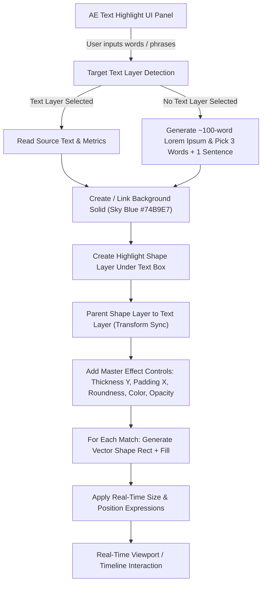

# AE Text Highlight (v1.0)

**Live Demo**: [https://work2survive.github.io/AE_JS_builder/?jsx=AE_Text_Highlight.jsx&autobuild=true](https://work2survive.github.io/AE_JS_builder/?jsx=AE_Text_Highlight.jsx&autobuild=true)

**AE Text Highlight** is a parametric, expression-rigged Adobe After Effects ScriptUI panel that detects the exact geometric position of specified words, character sequences, or full sentences inside any text layer and places procedural vector highlight blocks directly underneath the text.

> **Live Browser Simulator**: Test, customize, and preview this tool interactively in the [AE JS & ScriptUI Simulator](https://work2survive.github.io/AE_JS_builder/?jsx=AE_Text_Highlight.jsx&autobuild=true) directly in your browser without launching After Effects!

---

## ✨ Features

### 1. Smart Target Detection & Lorem Ipsum Auto-Generation
- **Active Layer Binding**: Detects if any Text Layer is currently selected in the active composition and attaches the highlight rig directly to it.
- **Automatic Fallback (~100 Words)**: If **no text layer is selected** when applied, the tool automatically:
  1. Generates a multi-line, formatted ~100-word *"Lorem Ipsum sit amet..."* text layer.
  2. Randomly selects **3 distinct words** (>= 5 letters) and **1 full sentence** from the paragraph.
  3. Immediately applies procedural highlight blocks to all 4 selections.
- **Reference Demo Preset**: Includes a one-click *"📷 Slow Living (Demo)"* preset that loads the exact quote, words (`present moment`, `Slow living`, `Slow down`, `present...moment`), hot pink highlight, and sky blue background shown in the reference design.

### 2. Real-Time Procedural Rigging
- **True Stacking Order**: Highlight blocks are generated as a native vector Shape Layer placed **directly below** the text layer and above the background plate.
- **Full Transformation Parenting**: The highlight shape layer is parented to the text layer (`shapeLayer.parent = textLayer`). Moving, scaling, rotating, or animating the text layer automatically carries the highlight blocks in 100% lockstep with zero latency.
- **Dynamic Expression Engine**: Each highlight box's `Size` and `Position` properties are driven by procedural After Effects expressions:
  - Dynamically calculates line wrapping, line index, and column offset.
  - Dynamically measures character widths, line height (`leading`), and justification (`left`, `center`, `right`).
  - **Real-Time Responsiveness**: When you edit the text, change font size, change font family, or adjust line breaks, the highlight blocks instantly reposition and resize themselves!
  - **Graceful Deletion Handling**: If a highlighted word is deleted from the text, its highlight box automatically collapses to `[0, 0]` (hides cleanly without expression errors). When re-typed, it instantly reappears.

### 3. Typography & Geometry Engine
- **Thickness Y (Ascender to Descender)**:
  - **Default: `0 px`**: By default, the highlight block height is strictly and tightly locked to the font's **Ascender to Descender** vertical span (`top = -0.75 * fontSize`, `bottom = +0.25 * fontSize`).
  - Scrubbable slider allows adding extra vertical breathing room or tightening the fit.
- **Padding X**:
  - Horizontal margin on the left and right sides of words/phrases (default: `8 px`).
- **Roundness**:
  - Corner radius control in pixels.
  - Set to `0 px` for sharp square / rectangular blocks.
  - Set to `> 0 px` (default: `6 px`) for sleek rounded capsules.

### 4. Color, Opacity & Background Controls
- **Highlight Fill Color**: Live hex input, color picker, and quick swatches (*Hot Pink* `#FF2D78`, *Cyber Gold* `#FFE600`, *Mint Neon* `#00F59B`, *Sky Cyan* `#00D2FF`, *Lavender* `#C084FC`).
- **Highlight Opacity**: Slider from `0%` to `100%` (default `100%`).
- **Background Plate**:
  - Option to create or link a background solid/plate layer.
  - Pre-calibrated palette: *Sky Blue* (`#74B9E7`, matching reference visual), *Slate Dark* (`#0F172A`), and *Clean White* (`#F8FAFC`).

---

## 📐 Architecture & Workflow

---

## 🔬 Mathematical Specifications

### 1. Ascender-to-Descender Height
In digital Latin typography:
$$\text{Ascent} \approx 0.75 \times \text{fontSize}$$
$$\text{Descent} \approx 0.25 \times \text{fontSize}$$
$$\text{EmHeight} = \text{Ascent} + \text{Descent} = 1.0 \times \text{fontSize}$$

When **Thickness** is set to `0`:
$$\text{BoxHeight} = \text{fontSize} \times 1.0$$
$$\text{CenterY} = (\text{lineIndex} \times \text{lineHeight}) - (\text{fontSize} \times 0.25)$$

This guarantees the highlight box exactly covers all capital letters, ascenders (e.g. `b`, `d`, `h`, `k`, `l`), and descenders (e.g. `g`, `j`, `p`, `q`, `y`).

### 2. Proportional Character Width
$$\text{BoxWidth} = \left(\sum_{k=0}^{N-1} \text{charWidth}(c_k, \text{fontSize})\right) + 2 \times \text{paddingX}$$

---

## 🚀 Installation & Usage in After Effects

### Method A: ScriptUI Panels (Dockable Panel)
1. Download [`AE_Text_Highlight.jsx`](AE_Text_Highlight.jsx).
2. Copy `AE_Text_Highlight.jsx` into your Adobe After Effects ScriptUI folder:
   - **Windows**: `C:\Program Files\Adobe\Adobe After Effects <Version>\Support Files\Scripts\ScriptUI Panels\`
   - **macOS**: `/Applications/Adobe After Effects <Version>/Scripts/ScriptUI Panels/`
3. Restart After Effects (or navigate to `Window` menu).
4. Click **AE Text Highlight.jsx** to open as a dockable panel.

### Method B: Floating Script Execution
1. In After Effects, go to **File > Scripts > Run Script File...**
2. Select `AE_Text_Highlight.jsx`.

---

## 🛠 ScriptUI Controls Overview

| Control | Description | Default |
| :--- | :--- | :--- |
| **Target Text Layer** | Displays currently bound layer; "Detect Selection" re-scans comp. | Auto-detect |
| **Highlight Targets** | Multi-line text field for words, phrases, or sentences to highlight. | 3 words + 1 sentence |
| **🎲 Pick 3 Words + 1 Sent** | Auto-extracts 3 random words and 1 full sentence from the text. | Click to re-roll |
| **📷 Slow Living (Demo)** | Loads the exact quote and highlights from the reference image. | Preset |
| **Thickness Y** | Vertical expansion beyond font ascender/descender (0 = strict fit). | `0 px` |
| **Padding X** | Horizontal padding on the left and right of words. | `8 px` |
| **Roundness** | Corner radius (0 = sharp square blocks, >0 = rounded rects). | `6 px` |
| **Highlight Color** | Color picker + Hex input + 5 one-click palette presets. | `#FF2D78` (Pink) |
| **Highlight Opacity** | Slider from 0% to 100%. | `100%` |
| **Create Background Plate**| Generates a solid plate at the bottom of the comp. | `Checked` (`#74B9E7`) |
| **► Build Highlights** | Primary build action (auto-detected in browser simulator). | Action |
| **⟳ Update Properties** | Pushes updated slider values to existing shape layer in real time. | Action |

---

## 📄 License

This project is licensed under the [MIT License](LICENSE) - see the LICENSE file for details.
