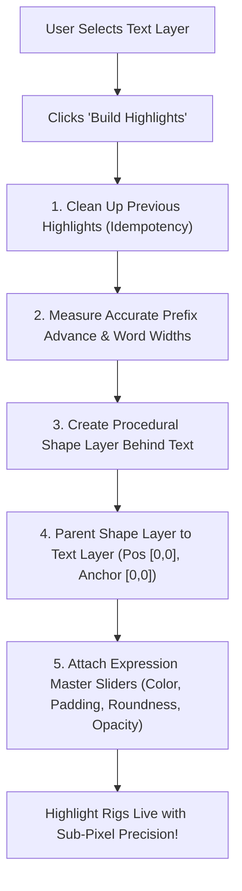

# AE Text Highlight (v3.0.0)

**Live Demo**: [https://work2survive.github.io/AE_JS_builder/?jsx=AE_Text_Highlight.jsx&autobuild=true](https://work2survive.github.io/AE_JS_builder/?jsx=AE_Text_Highlight.jsx&autobuild=true)

**AE Text Highlight v3.0.0** is a streamlined, lightweight procedural typography highlighter for Adobe After Effects ScriptUI and the [AE JS & ScriptUI Simulator](https://work2survive.github.io/AE_JS_builder/).

Completely rewritten from the ground up for maximum simplicity, predictability, and 100% deterministic consistency.

---

## 🎯 Key Design Innovations (v3.0.0 Ground-Up Rewrite)

1. **100% Idempotent & Deterministic**:
   - Re-running the script on a text layer cleans up and replaces previous highlights in-place.
   - Zero duplicated, stacked, or orphaned layers.
   - Deterministic target matching: never picks random words or unpredictable samples.

2. **Zero Premature Layer Creation**:
   - Zero layers or helper items are created on panel launch, window focus, or selection polling.
   - Layers are created **strictly and only** when the user clicks **"✨ Build Highlights"**.

3. **Untouched Original Text Layer**:
   - The original text layer's anchor point, position, scale, and rotation are **never modified**.
   - The procedural highlight Shape Layer is parented directly to the text layer and compensates internally for the parent's anchor point `[curAx, curAy]`.

4. **Multi-Word & Comma Support**:
   - Targets can be full multi-word phrases or sentences containing internal commas (e.g. `"peace of mind, body, and soul"`).
   - Enter targets one per line in the clean ScriptUI text area.

5. **Sub-Pixel Delimiter-Anchored Advance**:
   - Uses delimiter-anchored advance (`"|"` suffix) to measure true word bounds including trailing whitespace, preventing After Effects' native whitespace trimming from throwing off coordinates.

6. **Ultra-Clean Codebase**:
   - Reduced from ~3,400 lines of convoluted legacy code down to **~560 lines** of clear, modular JavaScript.

---

## 🏛️ How It Works

---

## 🛠️ Usage

1. Open After Effects and open your composition containing a Text Layer.
2. Run `AE_Text_Highlight.jsx` via **File > Scripts > Run Script File...** or install in `Scripts/ScriptUI Panels`.
3. Select the text layer you want to highlight.
4. Enter target words or phrases (one per line).
5. Adjust Padding, Roundness, and Highlight Color.
6. Click **✨ Build Highlights**.
7. To revert or remove highlights, click **🗑️ Remove Highlights**.

---

## 📜 License

MIT License. Co-authored & architected with Google DeepMind Antigravity for `work2survive`.
