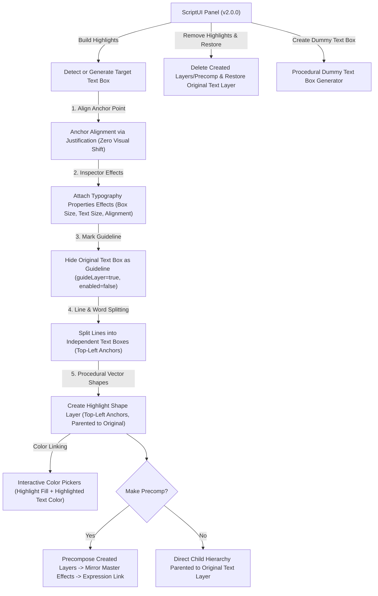

# AE Text Highlight (v2.0.0)

**Live Demo**: [https://work2survive.github.io/AE_JS_builder/?jsx=AE_Text_Highlight.jsx&autobuild=true](https://work2survive.github.io/AE_JS_builder/?jsx=AE_Text_Highlight.jsx&autobuild=true)

**AE Text Highlight v2.0.0** is an architectural rebuild and procedural typography rigging engine for Adobe After Effects ScriptUI and the [AE JS & ScriptUI Simulator](https://work2survive.github.io/AE_JS_builder/). It decomposes paragraph box text and point text layers into mathematically calibrated, independent sub-pixel text boxes with top-left anchor points, aligns anchor points based on text justification with zero visual shift, rigs procedural vector highlight boxes behind highlighted words, provides interactive color pickers for both highlight boxes and highlighted text, supports precomposition with mirrored expression controls, and offers one-click non-destructive removal and restoration.

---

## 🏛️ v2.0.0 Core Architecture & Pipeline

---

## 🚀 What's New in v2.0.0

### 1. Justification-Based Zero-Shift Anchor Alignment
- **Knowledge Base**: [AE-Align-AnchorPoint](https://github.com/work2survive/AE-Align-AnchorPoint) & [AE_VS_JS_TEXT_RENDERING_DIFFERENCES.md](https://github.com/work2survive/AE_JS_builder/blob/main/AE_VS_JS_TEXT_RENDERING_DIFFERENCES.md).
- Prior to decomposition, the original text box anchor point is aligned based on its justification:
  - **Left Justified** $\to$ Top-Left
  - **Center Justified** $\to$ Top-Center
  - **Right Justified** $\to$ Top-Right
- **Zero Visual Shift**: Compensates layer position simultaneously so the visual layout in the composition does not shift by even a fraction of a pixel.

### 2. Live Typography Inspector Effects Controls
- **Knowledge Base**: [Text_Properties_To_Effects.jsx](https://github.com/work2survive/AE_JS_builder/blob/main/samples/Text_Properties_To_Effects.jsx).
- Attaches live expression and slider controls to the original text layer:
  - `Box Text Width`, `Box Text Height`
  - `Text Width`, `Text Height`
  - `Visual Center Offset`
  - `Alignment Index` (`0=Left`, `1=Center`, `2=Right`)
  - `Is Paragraph Box Text` (`1=Yes`, `0=No`)
  - `Anchor Align X`, `Anchor Align Y`

### 3. Visual Line & Word Splitting Engine
- **Knowledge Base**: [AE_Text_Precomp.jsx](https://github.com/work2survive/AE_JS_builder/blob/main/samples/AE_Text_Precomp.jsx) / [AE-text-precomp](https://github.com/work2survive/AE-text-precomp).
- Detects which visual lines contain highlighted target words:
  - **Unhighlighted Lines**: Preserved as single independent text box layers (`[Line N]`).
  - **Highlighted Lines**: Split into separate non-highlight text segments (`[HL-Text]`) and dedicated target word boxes (`[HL-Target]`).
- **Top-Left Anchor Pinning**: All generated text boxes have their anchor point strictly assigned to Top-Left (`[r.left, r.top]`).
- **Delimiter-Anchored Advance**: Positions words along the exact baseline using sub-pixel delimiter measurement (`measurer.measurePrefixAdvance()`), completely eliminating font-specific kerning drift across Georgia, Cambria, Arial, and other typefaces.

### 4. Procedural Vector Highlight Shapes Layer
- Creates a dedicated vector Shape Layer (`OriginalName - Highlights`) parented to the original text layer.
- Builds a procedural rounded rectangle for each highlighted word box:
  - Anchor point pinned to Top-Left.
  - Size dynamically expression-linked to `Padding X` and `Thickness Y`.
  - Position dynamically expression-linked to `Offset X` and `Offset Y`.
  - Corner radius dynamically expression-linked to `Roundness`.
  - Fill color dynamically expression-linked to `Highlight Color`.
  - Opacity dynamically expression-linked to `Highlight Opacity`.
- Automatically expressions the `Source Text` fill color of `[HL-Target]` text layers to match the `Highlighted Text Color` master control.

### 5. Dual Interactive Color Pickers
- **Knowledge Base**: [custom_rounded_rect.jsx](https://github.com/work2survive/AE_JS_builder/blob/main/jsx/custom_rounded_rect.jsx).
- Interactive vector swatch buttons and hex editors:
  - **Highlight Box Color**: Controls the background fill of the highlight shapes.
  - **Highlighted Text Color**: Controls the typography color of the target words.
- Supports native `$.colorPicker`, Windows OS picker, and browser color input in simulator mode.

### 6. Mirrored Precomposition Option
- **"Make Precomp Out of Rig"**:
  - Precomposes all created split text layers and the highlight shape layer.
  - Automatically mirrors all master effect controls onto the precomp layer in the main composition.
  - Expression-links inner shape effects directly back to the parent precomp layer (`comp("Main Comp").layer("Precomp Layer").effect("...")`).
  - Parents the precomp layer to the hidden guideline original text box.

### 7. Non-Destructive "Remove Highlights & Restore"
- Cleans up all child layers (`[Line N]`, `[HL-Text]`, `[HL-Target]`, `- Highlights`, and precomp layers).
- Restores the original text layer to its fully active state (`guideLayer = false`, `enabled = true`) and selects it.

### 8. Dedicated "Create Dummy Text Box" Testing Generator
- Tabbed controls with customizable **Font** (`Georgia`, `Arial`, `Cambria`, etc.) and **Justification** (`Left`, `Center`, `Right`).
- Generates a 950x450 paragraph box text layer with realistic multiline text ready for testing.

---

## 🛠️ ScriptUI Controls Reference

| Control | Location | Description | Default |
| :--- | :--- | :--- | :--- |
| **Highlight Targets** | Main Panel | Multiline textarea for words, phrases, or sentences to highlight. | Auto-sampled |
| **Highlight Color** | Main Panel | Interactive swatch & hex editor for highlight box fill. | `#FF296D` (Hot Pink) |
| **Text Color** | Main Panel | Interactive swatch & hex editor for highlighted word text. | `#FFFFFF` (White) |
| **Make Precomp Out of Rig** | Main Panel | Precomposes created layers with mirrored master effect controls. | `false` |
| **Padding X** | Geometry Panel | Horizontal padding on left and right of highlight boxes. | `6 px` |
| **Thickness Y** | Geometry Panel | Vertical expansion of highlight boxes. | `4 px` |
| **Roundness** | Geometry Panel | Corner radius for highlight boxes (0 = square, >0 = pill/capsule). | `6 px` |
| **Offset X / Y** | Geometry Panel | Fine-tuning position offsets. | `0 px` |
| **Opacity** | Geometry Panel | Fill opacity from 0% to 100%. | `100%` |
| **Create Dummy Text Box** | Advanced Tab | Generates paragraph box text for testing with custom font & align. | Action |
| **Remove Highlights** | Footer | Deletes generated rig layers / precomp and restores original text box. | Action |
| **Build Highlights** | Footer | Executes anchor alignment, line/word splitting, and procedural rigging. | Action |

---

## 📄 License

This project is licensed under the [MIT License](LICENSE) - see the LICENSE file for details.
