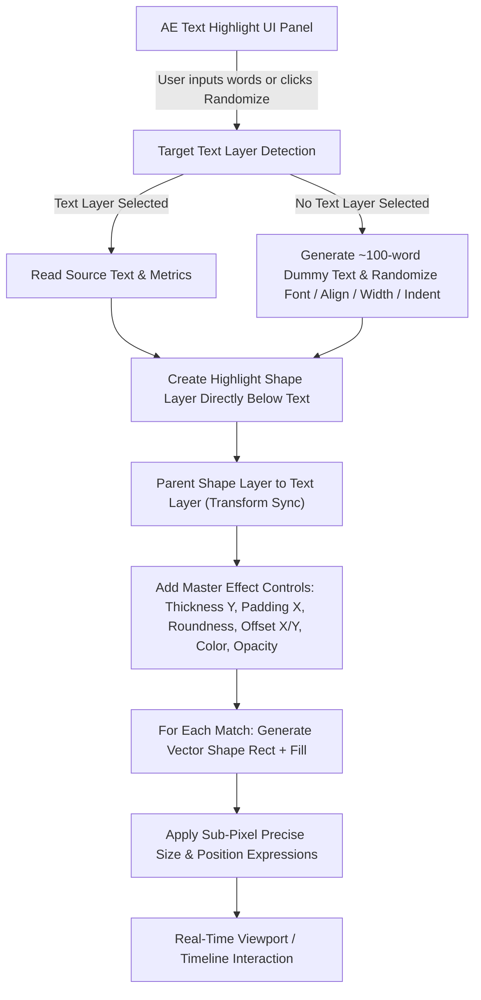

# AE Text Highlight (v1.4.1)

**Live Demo**: [https://work2survive.github.io/AE_JS_builder/?jsx=AE_Text_Highlight.jsx&autobuild=true](https://work2survive.github.io/AE_JS_builder/?jsx=AE_Text_Highlight.jsx&autobuild=true)

**AE Text Highlight** is a parametric, expression-rigged Adobe After Effects ScriptUI panel that detects the exact geometric position of specified words, character sequences, or full sentences inside any text layer and places procedural vector highlight blocks directly underneath the text with **zero cumulative offset**.

> **Live Browser Simulator**: Test, customize, and preview this tool interactively in the [AE JS & ScriptUI Simulator](https://work2survive.github.io/AE_JS_builder/?jsx=AE_Text_Highlight.jsx&autobuild=true) directly in your browser without launching After Effects!

---

## ✨ Features & What's New

### 🚀 What's New in v1.4.1
- **Fixed After Effects Dockable Panel Squeezed Layout**:
  - Attached dynamic `win.onResizing = win.onResize = function() { this.layout.resize(); };` event listener for dockable ScriptUI panels so the layout recalculates immediately when docked or resized in the AE workspace.
  - Added explicit `alignment = ["fill", "top"]` and `alignment = ["fill", "fill"]` to all panels, tabbed panels, tabs, rows, and buttons.
  - Converted hardcoded dimension assignments to flexible `[-1, height]` and slider `alignment = ["fill", "center"]`, allowing the UI to expand and fill the panel width without horizontal clipping.
  - Set `win.minimumSize = [280, 420];` to prevent panel elements from collapsing into narrow columns.

### 🚀 What's New in v1.4.0
- **"Make Precomp Out of Text Box" Integration** (Reference: [`AE_Text_Precomp.jsx`](https://github.com/work2survive/AE-text-precomp)):
  - Added a **"Make Precomp Out of Text Box"** checkbox directly into the Text Box tab.
  - Precomposes both the text box and procedural highlight layers into a cleanly cropped precomposition matching the exact paragraph box dimensions.
  - **Zero Visual Shift**: Mathematically calculates the origin shift and compensates position, anchor point, scale, and rotation so neither the text nor the highlights jump on screen.
- **Dedicated 3-Tab Architecture**:
  - **📝 Text Box**: Focused purely on target text layer detection, precomposition checkbox, and target phrase/word entry.
  - **🎲 Dummy Text**: Moved dummy text generator and multi-attribute randomizer into its own dedicated tab with clear guidance: *"⚠️ Dummy Text Generator ONLY applies when NO text layer is selected"*.
  - **🎨 Appearance**: Geometry controls and interactive color management.
- **Interactive Color Picker** (Reference: [`custom_rounded_rect.jsx`](https://github.com/work2survive/AE_JS_builder/blob/main/jsx/custom_rounded_rect.jsx)):
  - Replaced static text inputs with an interactive vector swatch button and hex editor.
  - Supports AE ExtendScript desktop `$.colorPicker`, Windows OS color picker, and web browser color selection.
  - Live synchronization between color swatch, hex input, and curated look presets.

### 🚀 What's New in v1.3.0
- **Integrated Text & Box Properties Engine** (Reference: [`Text_Properties_To_Effects.jsx`](https://github.com/work2survive/AE_JS_builder/blob/main/samples/Text_Properties_To_Effects.jsx)):
  - **Comprehensive Property Extraction**: Extracts complete typography and box metrics: `boxText`, `boxTextSize`, `sourceRectAtTime()` (`left`, `top`, `width`, `height`), `fontSize`, `leading`, `tracking`, `baselineShift`, `strokeWidth`, `indentLeft`, and `indentRightSpare`.
  - **In-Memory Typography Metrics Store**: Caches words, word widths, visual lines, line widths, and space width in `$.global.AE_TEXT_BOX_MEMORY` and `layer._textMetrics`.
  - **Fixed Paragraph Justification Enums**: Full support for native After Effects ExtendScript justification enums (`ParagraphJustification.LEFT_JUSTIFY` / `7412`, `RIGHT_JUSTIFY` / `7413`, `CENTER_JUSTIFY` / `7414`, and full justify enums `7415`–`7418`).
- **Eliminated Offset & Wrong-Word Targeting**:
  - Replaced fragile character index projections with line-by-line token matching, eliminating offsets that previously caused highlights to drift onto adjacent words (such as targeting *voluptatem* and highlighting *porro*).
  - Accurate anchor centering for Left, Center, and Right justified paragraph boxes.
  - Multi-line phrase and sentence support across soft paragraph line wraps.
- **Clean Appearance**: Background plates and options remain completely removed.

### 🚀 What's New in v1.2.1
- **Fixed `currentOffsetX is undefined` Runtime Bug**: Passed `offsetX` and `offsetY` directly into `createHighlightGroups` with safe numerical fallbacks, eliminating the ExtendScript alert thrown when building highlights.
- **Removed All Background Options**: Completely removed Background Plate controls, presets, and layer generation logic per user specification. No background solid or shape layer is created; only procedural highlight blocks parented to the text layer are generated.

### 🚀 What's New in v1.2.0
- **Modern Tabbed Interface**: Redesigned ScriptUI Panel into two clean tabs matching Suite UX standards:
  - **📝 Text Box**: Target text layer detection, dummy text generator & multi-attribute randomizer (Font, Alignment, Box Width, Indent), and highlight target input (multiline textarea with quick-action buttons).
  - **🎨 Appearance**: Thickness Y, Padding X, Roundness, Offset X/Y, and Highlight Color & Opacity with color swatches.
- **Curated Styling Presets**: Quick dropdown with curated looks (*Hot Pink*, *Neon Mint*, *Golden Glow*, *Electric Cyan*, *Lavender Dream*, *Slow Living Demo*).
- **ExtendScript Property Group Invalidation Fix**: Precomputed geometry and fully configured vector shapes before attaching expressions to prevent `Object is invalid` errors.

### 1. Sub-Pixel Precision & Zero Cumulative Offset
- **Exact Measurement Engine**: Sub-pixel Canvas 2D measurement stack (`document.createElement('canvas').getContext('2d')`) matching the browser's SVG font engine and calibrated fallback metric tables for desktop After Effects ExtendScript.
- **Zero Drift**: Eliminates cumulative position error so words deep into long lines (or at the very end of sentences) are centered with 100% precision.

### 2. Procedural Dummy Text Generation & Multi-Attribute Randomization
- When **no text layer is selected**, running the tool creates a ~100-word *"Lorem ipsum dolor sit amet..."* dummy text layer and randomizes:
  - **Font**: Selected from typical system fonts (`Georgia`, `Arial`, `Times New Roman`, `Verdana`, `Trebuchet MS`, `Courier New`, `Impact`).
  - **Alignment**: `Left`, `Center`, or `Right` justification.
  - **Text Box Width**: Randomly chosen (700px – 1200px) with procedural word wrapping to fit the exact width.
  - **First-Line Indent**: Randomly applied (0px, 24px, 48px, 72px).
  - **Highlight Targets**: Automatically extracts **3 random distinct words** and **1 full sentence** from the wrapped text.
- **One-Click Randomization**: Use the *"🎲 Randomize Dummy & Layout"* button in the ScriptUI panel to re-roll fonts, widths, indents, and alignments at any time.

### 3. Real-Time Procedural Rigging
- **True Stacking Order**: Highlight blocks are generated on a dedicated vector Shape Layer placed **directly below** the text layer.
- **Transformation Parenting**: The shape layer is parented to the text layer (`shapeLayer.parent = textLayer`). Moving, scaling, rotating, or animating the text layer carries the highlight blocks in lockstep.
- **Dynamic Expression Engine**: Each highlight box's `Size` and `Position` properties evaluate procedural expressions:
  - Dynamically recalculates line wrapping, line index, and column offset.
  - Dynamically measures character widths, line leading, and justification.
  - **Graceful Deletion Handling**: If a highlighted word is deleted from the text, its block collapses to `[0, 0]` without expression errors, and reappears when typed back in.

### 4. Typography & Geometry Engine
- **Thickness Y (Ascender to Descender)**:
  - **Default: `0 px`**: Strictly and tightly locked to the font's **Ascender to Descender** vertical span ($\text{Top} = -0.75 \times \text{fontSize}$, $\text{Bottom} = +0.25 \times \text{fontSize}$, $\text{CenterY} = -0.25 \times \text{fontSize}$).
  - Slider allows adding extra vertical breathing room or tightening the fit.
- **Padding X**:
  - Horizontal margin on the left and right sides of words/phrases (default: `8 px`).
- **Roundness**:
  - Corner radius control in pixels (0 = sharp square blocks, >0 = rounded rects / capsules).
- **Offset X & Offset Y**:
  - Master fine-tuning sliders to adjust position alignment in real time.

### 5. Color & Opacity Controls
- **Highlight Fill Color**: Live hex input and quick swatches (*Hot Pink* `#FF2D78`, *Cyber Gold* `#FFE600`, *Mint Neon* `#00F59B`, *Sky Cyan* `#00D2FF`, *Lavender* `#C084FC`).
- **Highlight Opacity**: Slider from `0%` to `100%` (default `100%`).

---

## 📐 Architecture & Workflow

---

## 🛠 ScriptUI Controls Overview

| Control | Description | Default |
| :--- | :--- | :--- |
| **Presets Dropdown** | Curated styling presets (Hot Pink, Neon Mint, Golden Glow, Electric Cyan, Lavender, Slow Living). | Hot Pink |
| **Target Text Layer** | Displays currently bound layer; "Detect Selection" re-scans comp. | Auto-detect |
| **🎲 Randomize Dummy & Layout** | Re-rolls font, alignment, text box width, indent, and picks 3 words + 1 sentence. | Action |
| **Font Dropdown** | Select from typical system fonts (Georgia, Arial, Times, Verdana, etc.). | Random |
| **Align Dropdown** | Paragraph justification (Left, Center, Right). | Random |
| **Box Width Slider** | Target width for automatic word-wrapping (600px - 1300px). | `950 px` |
| **Indent Slider** | First-line paragraph indentation (0px - 80px). | `0 px` |
| **Highlight Targets** | Multi-line text field for words, phrases, or sentences to highlight. | 3 words + 1 sentence |
| **🎲 Re-Pick 3 Words + 1 Sent** | Auto-extracts 3 random words and 1 full sentence from the current text. | Action |
| **📷 Slow Living (Demo)** | Loads the exact quote and highlights from the reference image. | Preset |
| **Thickness Y** | Vertical expansion beyond font ascender/descender (0 = strict fit). | `0 px` |
| **Padding X** | Horizontal padding on the left and right of words. | `8 px` |
| **Roundness** | Corner radius (0 = sharp square blocks, >0 = rounded rects). | `6 px` |
| **Offset X / Y** | Fine-tuning position offsets in pixels. | `0 px` |
| **Highlight Color** | Hex input + 5 one-click palette presets. | `#FF2D78` (Pink) |
| **Highlight Opacity** | Slider from 0% to 100%. | `100%` |
| **🖊️ Create Highlight Layer** | Primary build action (auto-detected in browser simulator). | Action |
| **⟳ Update Properties** | Pushes updated slider values to existing shape layer in real time. | Action |

---

## 📄 License

This project is licensed under the [MIT License](LICENSE) - see the LICENSE file for details.
