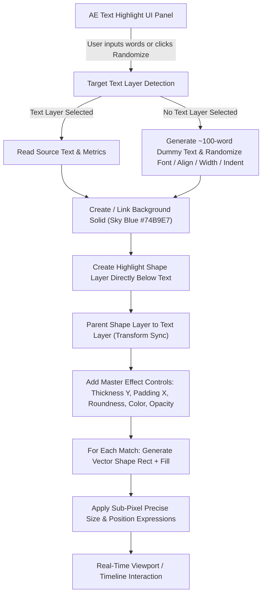

# AE Text Highlight (v1.1.1)

**Live Demo**: [https://work2survive.github.io/AE_JS_builder/?jsx=AE_Text_Highlight.jsx&autobuild=true](https://work2survive.github.io/AE_JS_builder/?jsx=AE_Text_Highlight.jsx&autobuild=true)

**AE Text Highlight** is a parametric, expression-rigged Adobe After Effects ScriptUI panel that detects the exact geometric position of specified words, character sequences, or full sentences inside any text layer and places procedural vector highlight blocks directly underneath the text with **zero cumulative offset**.

> **Live Browser Simulator**: Test, customize, and preview this tool interactively in the [AE JS & ScriptUI Simulator](https://work2survive.github.io/AE_JS_builder/?jsx=AE_Text_Highlight.jsx&autobuild=true) directly in your browser without launching After Effects!

---

## ✨ Features & What's New in v1.1

### 1. Sub-Pixel Precision & Zero Cumulative Offset
- **Exact Measurement Engine**: Replaced rough glyph estimates with a sub-pixel Canvas 2D measurement stack (`document.createElement('canvas').getContext('2d')`) matching the browser's SVG font engine.
- **Zero Drift**: Eliminates the cumulative position error so words deep into long lines (or at the very end of sentences) are centered with 100% precision.
- **Calibrated Fallback**: Includes fractional font metric tables for desktop After Effects ExtendScript when running outside browser environments.

### 2. Procedural Dummy Text Generation & Multi-Attribute Randomization
- When **no text layer is selected**, running the tool creates a ~100-word *"Lorem ipsum dolor sit amet..."* dummy text layer and randomizes:
  - **Font**: Selected from typical system fonts available on every computer:
    - `Georgia` (Serif)
    - `Arial` (Clean Sans)
    - `Times New Roman` (Classic Serif)
    - `Verdana` (Wide Sans)
    - `Trebuchet MS` (Modern Sans)
    - `Courier New` (Monospace)
    - `Impact` (Condensed Bold)
  - **Alignment**: `Left`, `Center`, or `Right` justification.
  - **Text Box Width**: Randomly chosen (700px – 1200px) with procedural word wrapping to fit the exact width.
  - **First-Line Indent**: Randomly applied (0px, 24px, 48px, 72px).
  - **Highlight Targets**: Automatically extracts **3 random distinct words** and **1 full sentence** from the wrapped text.
- **One-Click Randomization**: Use the *"🎲 Randomize Dummy & Layout"* button in the ScriptUI panel to re-roll fonts, widths, indents, and alignments at any time.

### 3. Real-Time Procedural Rigging
- **True Stacking Order**: Highlight blocks are generated on a dedicated vector Shape Layer placed **directly below** the text layer and above the background plate.
- **Transformation Parenting**: The shape layer is parented to the text layer (`shapeLayer.parent = textLayer`). Moving, scaling, rotating, or animating the text layer carries the highlight blocks in lockstep.
- **Dynamic Expression Engine**: Each highlight box's `Size` and `Position` properties evaluate procedural expressions:
  - Dynamically recalculates line wrapping, line index, and column offset.
  - Dynamically measures character widths, line leading, and justification.
  - **Graceful Deletion Handling**: If a highlighted word is deleted from the text, its block collapses to `[0, 0]` without expression errors, and reappears when typed back in.

### 4. Typography & Geometry Engine
- **Thickness Y (Ascender to Descender)**:
  - **Default: `0 px`**: Strictly and tightly locked to the font's **Ascender to Descender** vertical span ($\text{Top} = -0.75 \times \text{fontSize}$, $\text{Bottom} = +0.25 \times \text{fontSize}$, $\text{CenterY} = -0.25 \times \text{fontSize}$).
  - Slider allows adding extra vertical breathing room or tightening the fit.
- **Padding X**:
  - Horizontal margin on the left and right sides of words/phrases (default: `8 px`).
- **Roundness**:
  - Corner radius control in pixels.
  - Set to `0 px` for sharp square / rectangular blocks.
  - Set to `> 0 px` (default: `6 px`) for sleek rounded capsules.

### 5. Color, Opacity & Background Controls
- **Highlight Fill Color**: Live hex input, color picker, and quick swatches (*Hot Pink* `#FF2D78`, *Cyber Gold* `#FFE600`, *Mint Neon* `#00F59B`, *Sky Cyan* `#00D2FF`, *Lavender* `#C084FC`).
- **Highlight Opacity**: Slider from `0%` to `100%` (default `100%`).
- **Background Plate**:
  - Option to create or link a background solid/plate layer.
  - Pre-calibrated palette: *Sky Blue* (`#74B9E7`, matching reference visual), *Slate Dark* (`#0F172A`), and *Clean White* (`#F8FAFC`).

---

## 📐 Architecture & Workflow

---

## 🛠 ScriptUI Controls Overview

| Control | Description | Default |
| :--- | :--- | :--- |
| **Target Text Layer** | Displays currently bound layer; "Detect Selection" re-scans comp. | Auto-detect |
| **🎲 Randomize Dummy & Layout** | Re-rolls font, alignment, text box width, indent, and picks 3 words + 1 sentence. | Action |
| **Font Dropdown** | Select from typical system fonts (Georgia, Arial, Times, Verdana, etc.). | Random |
| **Align Dropdown** | Paragraph justification (Left, Center, Right). | Random |
| **Box Width Slider** | Target width for automatic word-wrapping (600px - 1300px). | `950 px` |
| **Indent Slider** | First-line paragraph indentation (0px - 80px). | `0 px` |
| **Highlight Targets** | Multi-line text field for words, phrases, or sentences to highlight. | 3 words + 1 sentence |
| **🎲 Re-Pick 3 Words + 1 Sent** | Auto-extracts 3 random words and 1 full sentence from the current text. | Action |
| **📷 Slow Living (Demo)** | Loads the exact quote and highlights from the reference image. | Preset |
| **Thickness Y** | Vertical expansion beyond font ascender/descender (0 = strict fit). | `0 px` |
| **Padding X** | Horizontal padding on the left and right of words. | `8 px` |
| **Roundness** | Corner radius (0 = sharp square blocks, >0 = rounded rects). | `6 px` |
| **Highlight Color** | Color picker + Hex input + 5 one-click palette presets. | `#FF2D78` (Pink) |
| **Highlight Opacity** | Slider from 0% to 100%. | `100%` |
| **Create Background Plate**| Generates a solid plate at the bottom of the comp. | `Checked` (`#74B9E7`) |
| **► Build Highlights** | Primary build action (auto-detected in browser simulator). | Action |
| **⟳ Update Properties** | Pushes updated slider values to existing shape layer in real time. | Action |

---

## 📄 License

This project is licensed under the [MIT License](LICENSE) - see the LICENSE file for details.
